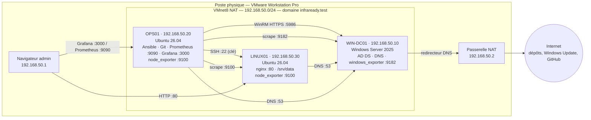

# Architecture

## Vue d'ensemble



## Rôles

| Machine | Rôle | Services |
|---|---|---|
| **WIN-DC01** | Annuaire et nom | AD DS (forêt `infraready.test`), DNS (zone directe + inverse, redirecteur), journaux Windows, windows_exporter |
| **OPS01** | Administration et supervision | Contrôleur Ansible (dépôt Git cloné dans `~/infraready`), Prometheus, Grafana, node_exporter |
| **LINUX01** | Services Linux | nginx (site `/var/www/infraready`), disque de données `/srv/data`, comptes et groupes Linux, node_exporter |

## Choix techniques

| Choix | Raison |
|---|---|
| **Trois VM séparées** (pas de fusion) | Ressources suffisantes ; séparation des rôles : la panne de LINUX01 n'affecte ni l'administration ni la supervision |
| **Réseau NAT dédié** plutôt que Host-only | Mises à jour possibles via la passerelle VMware, sans exposer de service sur le réseau de l'établissement |
| **Adresses fixes** | Un contrôleur de domaine et des cibles de supervision ne doivent pas changer d'adresse |
| **DNS du domaine pour tout le labo** | Résolution des noms `*.infraready.test` ; redirecteur vers la passerelle pour Internet |
| **Ansible sur OPS01**, SSH par clé vers Linux, **WinRM HTTPS** vers Windows | Transport chiffré pour les deux familles ; pas d'agent à installer |
| **Ansible Vault** | Aucun secret en clair dans le dépôt (mots de passe sudo, Windows, Grafana) |
| **Prometheus + exporters**, **Grafana provisionné** | Configuration versionnée dans `monitoring/`, tableau de bord et source de données chargés automatiquement |
| **Pare-feu sur les trois machines** | Seuls les flux de la matrice (`docs/adressage-ip.md`) sont ouverts |

## Écarts par rapport au sujet

| Écart | Conséquence | Traitement |
|---|---|---|
| Ubuntu **26.04** au lieu de 24.04 | sudo-rs par défaut, Python 3.14, `ansible-core` seul dans le PPA | `ansible_become_exe=sudo.ws` ; collections via `collections/requirements.yml` |
| Adresses LINUX01 / OPS01 inversées (.30 / .20) | Aucune | Documenté dans `docs/adressage-ip.md` |
| Inventaire `hosts.ini` au lieu de `hosts.yml` | Aucune | Format INI accepté par Ansible |
| GitHub Actions non exécuté | Pas d'exécution sur GitHub | Voir `docs/securite.md` et `scripts/ci/valider-local.sh` |

## Organisation du dépôt

```
infraready/
├── README.md
├── ansible.cfg                      inventaire, rôles, options
├── .ansible-lint · .yamllint        règles de validation
├── .github/workflows/validation.yml intégration continue (4 jobs)
├── collections/requirements.yml     collections Ansible requises
├── docs/                            architecture, adressage, sécurité, maintenance, incident
├── inventory/
│   ├── hosts.ini
│   └── group_vars/{linux,ops,windows}/  vars.yml + vault.yml (chiffré)
├── monitoring/
│   ├── prometheus.yml
│   ├── rules/                       règles d'alerte + tests unitaires
│   └── dashboards/infraready.json
├── playbooks/
│   ├── linux/                       nginx, comptes-permissions, stockage, maintenance
│   ├── windows/                     ad-groupes-utilisateurs, maintenance-windows
│   ├── monitoring.yml · pare-feu.yml · ping-all.yml · update_servers.yml
├── preuves/                         rapports générés (maintenance, validation)
└── scripts/
    ├── windows/New-InfraReadyADObjects.ps1
    └── ci/                          verifier-secrets.sh, valider-local.sh
```
